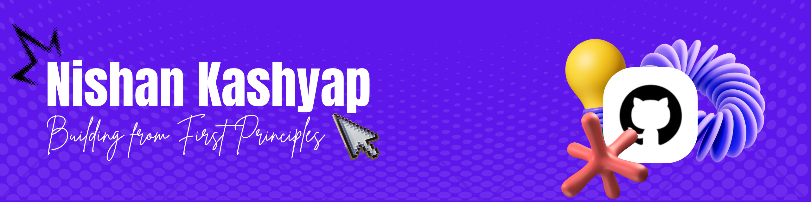
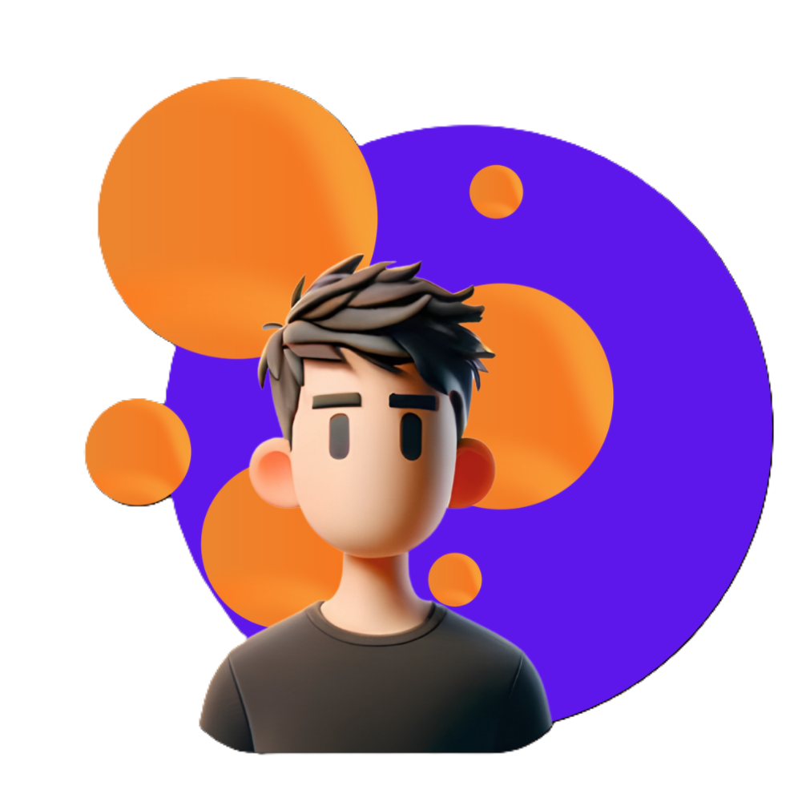

 <!-- ================================================= -->
<!-- BANNER -->
<!-- ================================================= -->

<!-- ================================================= -->
<!-- ABOUT ME -->
<!-- ================================================= -->

## About Me

<table>
<tr>
<td width="68%" valign="middle">

I'm Nishan, a Computer Science undergraduate and developer from Bengaluru, India.

I enjoy building software, exploring systems engineering, understanding complex technologies and turning unconventional ideas into working products.

Currently exploring distributed systems, Go, backend engineering, AI and infrastructure.
[Portfolio](https://nishankashyap.vercel.app/)

 

</td>

<td width="32%" align="center" valign="middle">

</td>
</tr>
</table>
<!-- ================================================= -->
<!-- TECH STACK -->
<!-- ================================================= -->

## Tech Stack

 

 

## Projects

<table>
<tr>
<td width="50%" valign="top" align="left">

<h3>01 &nbsp; KafkaZero</h3>

Building a Kafka-like distributed messaging system from scratch in Go, exploring broker architecture, protocols and distributed coordination.

`GO` &nbsp; `DISTRIBUTED SYSTEMS` &nbsp; `ZOOKEEPER`

 

<a href="https://github.com/nishankx/kafka-zero">↗ View Repository</a>

   

</td>
<td width="50%" valign="top" align="left">

<h3>02 &nbsp; Torrentis</h3>

Exploring peer-to-peer file transfer, distributed networking and the engineering behind decentralized communication.

`NETWORKING` &nbsp; `P2P`

 

<a href="https://github.com/nishankx?tab=repositories">↗ View Repository</a>

   

</td>
</tr>

<tr>
<td width="50%" valign="top" align="left">

<h3>03 &nbsp; GoRedis</h3>

Building an in-memory data store in Go while exploring Redis internals, data structures and network protocols.

`GO` &nbsp; `DATABASES` &nbsp; `NETWORKING`

 

<a href="https://github.com/nishankx?tab=repositories">↗ View Repository</a>

   

</td>
<td width="50%" valign="top" align="left">

<h3>04 &nbsp; OASIS</h3>

Collaborative engineering project focused on research, literature review, ideation and developing a novel solution.

`RESEARCH` &nbsp; `ENGINEERING`

 

<a href="https://github.com/HACK-A-DAY-Online-Participants/OASIS">↗ View Repository</a>

   

</td>
</tr>

<tr>
<td width="50%" valign="top" align="left">

<h3>05 &nbsp; Cachette</h3>

Working on desktop infrastructure, local services and native Windows installation workflows.

`ELECTRON` &nbsp; `PYTHON` &nbsp; `INFRASTRUCTURE`

 

<a href="https://github.com/cachette-cloud/cachette_client/tree/native-installer">↗ View Repository</a>

   

</td>
<td width="50%" valign="top" align="left">

<h3>06 &nbsp; TEDx</h3>

TEDx involvement and activities.

  

</td>
</tr>

<tr>
<td width="50%" valign="top" align="left">

<h3>07 &nbsp; Portfolio</h3>

My personal website showcasing my projects, experiments, interests and engineering journey.

`NEXT.JS` &nbsp; `REACT` &nbsp; `TAILWIND CSS`

 

<a href="https://nishankashyap.com">↗ Visit Website</a>

   

</td>
<td width="50%"></td>
</tr>
</table>

<!-- ================================================= -->
<!-- EXPERIENCE -->
<!-- ================================================= -->

## Experience

**Independent Developer & Builder**  
2026 — Present

Building independent projects across distributed systems, backend engineering, AI and developer infrastructure.

**Open Source & Engineering**  
Ongoing

Exploring open-source development, systems programming and collaborative software engineering.

**Computer Science Undergraduate**  
Bengaluru, India

Pursuing Computer Science while developing practical engineering skills through independent projects.

<!-- ================================================= -->
<!-- STATS -->
<!-- ================================================= -->

## Stats

 

  

  

Build. Experiment. Understand. Repeat.

